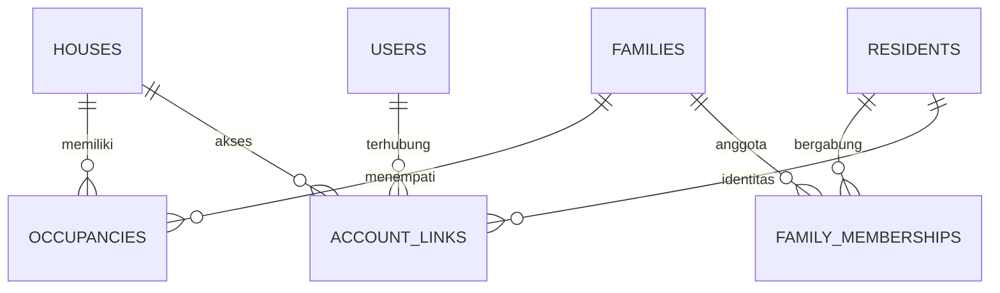
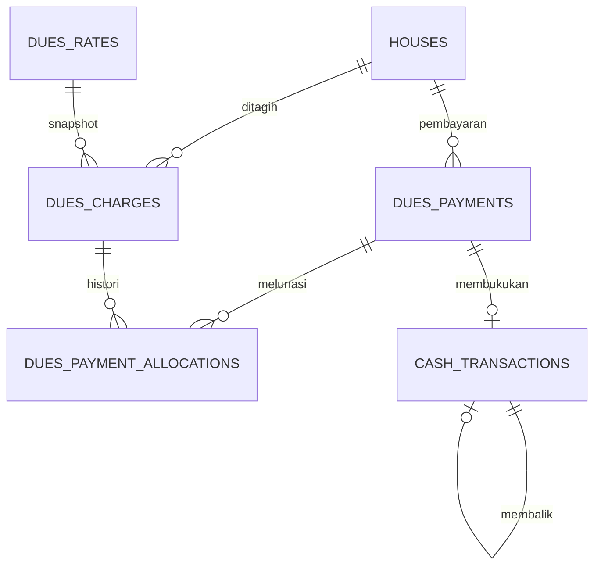

# ERD dan kamus data rancangan v1

## M19 — kejadian darurat (implementasi lokal, belum deploy)

`kejadian_darurat`: UUID; FK `pelapor_id → akun`, `rumah_id → rumah`, `ditangani_oleh_id → akun` (RESTRICT).
Kolom: `jenis` kebakaran/kemalingan/penyerangan/lainnya; `status` aktif/selesai/palsu; `penyalahgunaan` boolean;
`catatan_pengurus`, `selesai_at`, `versi >= 1`, `created_at`. CHECK mengikat penanganan, alasan dan waktu;
penyalahgunaan hanya pada status palsu. Unique parsial satu kejadian aktif per akun. Trigger melarang DELETE,
perubahan identitas/rumah/jenis/waktu asal, buka ulang, edit hasil terminal, dan transisi versi yang tidak berurutan.

`notifikasi.kejadian_darurat_id` FK nullable menambah konteks jenis `darurat`; CHECK tetap tepat satu konteks
sesuai jenis. `system_settings['darurat.fitur']` menyimpan `aktif`, default false, dengan versi dan audit.
Tidak ada snapshot nama/alamat di outbox, push, audit atau cache idempotensi M19. Detail memuat identitas
lewat referensi akun/rumah sehingga anonimisasi akun yang sudah ada tetap berlaku. Rumah adalah rumah saat
laporan dibuat; tampilan alamat/nama mengikuti data master terkini. Jangan menganggapnya snapshot alamat historis.

Satu advisory lock transaksi M19 mengurutkan kirim, penanganan dan perubahan pengaturan; akun dikunci NO KEY UPDATE
agar kompatibel dengan FK idempotensi. Nominal/ledger M18 tidak diubah. Migration down menolak jika riwayat ada.
Jangan rollback ke APK/API tanpa M19 setelah aktif tanpa memeriksa notifikasi jenis baru. Rincian: [M19_PLAN.md](M19_PLAN.md).

Rancangan ini melengkapi kebutuhan dalam paket, bukan salinan ERD lama yang belum tersedia. Tabel infrastruktur Laravel boleh menggunakan bentuk framework resmi. Agent membuat migration bertahap per milestone, tidak membuat seluruh schema spekulatif pada M01.

## Tambahan ledger M18 (implementasi lokal, belum aktivasi staging)

Migration `2026_10_25_000300_m18_finance_ledger.php` menambah:

| Tabel | Relasi dan aturan |
| --- | --- |
| tarif_rumah | Rumah, mulai_periode, mode khusus/umum, nominal, alasan, pembuat; versi dibatalkan + pengganti, satu versi aktif per rumah/bulan |
| tagihan_iuran | Tambahan tarif_rumah_id; nominal_tagihan tetap snapshot immutable |
| pembayaran_iuran | nominal_sumbangan, nominal_titipan, versi_keuangan; total penerimaan tetap sama dengan kas masuk |
| alokasi_pembayaran | Sumber XOR pembayaran_id / penggunaan_titipan_id; beberapa alokasi parsial per tagihan diperbolehkan |
| keringanan_iuran | Tagihan, pembayaran opsional, nominal positif, alasan, aktor, riwayat pembatalan; bukan uang masuk |
| penggunaan_titipan | Rumah, nominal, tanggal, aktor, riwayat pembatalan; tidak membuat penerimaan kas |
| mutasi_titipan | Lot dari satu pembayaran, arah ±1 dan nominal positif, pemakaian/pembalikan append-only; saldo tiap lot tidak negatif |
| penyesuaian_tagihan | Delta bertanda, alasan, aktor, referensi pembalikan; mengubah nominal efektif tanpa menimpa snapshot |
| konfirmasi_iuran | pembayaran_id nullable unique untuk persetujuan atomik pada tahap API berikutnya |

Views `rt05_tagihan_saldo`, `rt05_titipan_saldo`, `rt05_finance_violations` menghitung saldo dan penyimpangan.
Constraint trigger deferred memvalidasi keadaan akhir transaksi; advisory lock `rt05:keuangan` menserialkan perubahan ledger.
Pengecekan mencakup kas/penerimaan, sisa tagihan, status, sumber satu rumah, lot titipan, serta pembalikan.
Migrasi forward-only: rollback kode M17 setelah transaksi M18 dilarang. Flag `RT05_FINANCE_V2=false` default;
endpoint/mobile M18 belum tersedia pada tahap fondasi ini. Lihat [M18_PLAN.md](M18_PLAN.md).

Tahap API menambah migration `2026_10_26_000100_m18_confirmation_integrity.php`: field asli pengajuan bukti transfer
dikunci; transisi proses satu kali. View `rt05_konfirmasi_violations` dan constraint deferred memeriksa status selesai,
rumah sama dengan pembayaran, pemeriksa/waktu, serta alasan bila nominal penerimaan berbeda dari pengajuan.
Status selesai M17 tanpa pembayaran_id tetap histori; tidak dibuatkan pembayaran otomatis.

## Rumah, keluarga, akun (rancangan dasar)

Occupancy dan account link aktif mempunyai ended_at null. Primary aktif per rumah dibatasi constraint. Family membership menyimpan role keluarga dan rentang waktu. House tidak identik dengan akun.

| Tabel | Kolom penting dan relasi |
| --- | --- |
| users | id, name, email_normalized unique, password_hash, role resident/admin, status pending/active/inactive/archived, email_verified_at, notification_preferences json, archived_at |
| houses | id, code unique, block, street, number, address_key unique, ownership_note restricted, billing_enabled, billing_start_month, archived_at |
| families | id, head_resident_id FK residents nullable saat creation, verification_status, archived_at |
| residents | id, name, birth_year opsional, archived_at; tidak ada NIK wajib |
| family_memberships | id, family_id, resident_id, relationship, started_at, ended_at |
| occupancies | id, house_id, family_id, is_primary, occupancy_type owner/tenant, started_at, ended_at |
| account_links | id, user_id, resident_id, family_id, house_id, is_primary, started_at, ended_at |
| registration_invites | id, token_digest, token_ciphertext, activated_at, expires_at, revoked_at, rotated_by |
| additional_account_requests | id, user_id, target_house_id/target_family_id resolved privately, state, reviewed_by, reviewed_at, reason | (UAT M15: state `perlu_revisi`, ADR33)
| password_reset_tokens | Framework Laravel; email, token hash, created_at |
| personal_access_tokens | Sanctum; token hash, owner, abilities, expires_at, last_used_at |

Circular family.head_resident_id dibuat lewat migration/order dan registration transaction yang aman; family pertama dibuat dengan head null lalu dikaitkan sebelum commit.

### Implementasi M07 (nama ADR17)

Additive `2026_10_13_000100_m07_keanggotaan_tautan_akun`:

| Tabel | Kolom dan constraint |
| --- | --- |
| keanggotaan_keluarga (family_memberships) | keluarga_id, warga_id, hubungan_keluarga, mulai_at/selesai_at timestamptz, alasan_selesai, sumber, dicatat_oleh_id, diakhiri_oleh_id; unique aktif per warga; selesai ≥ mulai; alasan wajib saat selesai |
| tautan_akun (account_links) | akun_id, warga_id, keluarga_id, is_utama, mulai_at/selesai_at, alasan_selesai, sumber, aktor; unique aktif per akun dan per warga; unique `keluarga_id WHERE is_utama AND selesai_at IS NULL` |
| rumah | + versi (≥1) |
| permohonan_akun | + `nama_kepala_diajukan` varchar(120) null (additive `2026_10_21_000100`, ADR34); `alamat_diajukan` boleh null |
| warga, keluarga | + `nik` / `nomor_kk` text null, cast `encrypted` (additive `2026_10_21_000300`, ADR35) |
| warga | + `tanggal_lahir` date null (additive `2026_10_24_000100`, ADR42); umur/kelompok dihitung, tidak disimpan |
| akun | + `privasi_versi` varchar(20) null, `privasi_disetujui_at` timestamptz null (ADR35) |
| konfirmasi_iuran | id, akun_id, rumah_id, periode jsonb, nominal, catatan, storage_key/mime/bytes/lebar/tinggi, status diajukan/selesai/ditolak, catatan_pengurus, diproses_oleh_id, diproses_at; check status, check diproses_at ⇔ bukan diajukan (ADR35) |

Rumah tidak disimpan pada tautan: rumah akun = penghunian aktif keluarga tautannya. Karena
`penghunian` tetap satu aktif per rumah dan per keluarga, satu akun utama aktif per keluarga
setara dengan satu akun utama aktif per rumah, dan perpindahan rumah tidak memutar tautan.
Penghunian aktif = keluarga utama rumah (kolom is_primary tidak ditambahkan; v1 tidak membuka
hunian bukan-utama). mulai_at NULL = baris backfill sebelum M07. Backfill tidak membuat tautan
aktif untuk warga/keluarga yang sudah diarsipkan atau akun tanpa status aktif/nonaktif.

Pointer lama `warga.keluarga_id`, `warga.is_kepala`, `akun.warga_id` (unik), `akun.jenis`
dipertahankan untuk image M06 dan diperbarui dalam transaksi yang sama dengan histori.

## Layanan dan konten

| Tabel | Kolom penting dan relasi |
| --- | --- |
| complaints | id, author_user_id, house_id snapshot, category, title, body, anonymous_to_residents, status, version, archived_at |
| complaint_status_events | id, complaint_id, from_status, to_status, note, actor_id, created_at |
| foto_pengaduan (M08) | id, pengaduan_id, storage_key acak privat, mime, bytes, lebar, tinggi, urutan, status diproses/siap/gagal, percobaan, kode_gagal, created_at, updated_at |
| aspirations | id, author_user_id, house_id snapshot, title, body, anonymous_to_residents, status, version, archived_at |
| aspirasi (M09, nama aktual) | id, pengirim_id → akun, judul, isi, sembunyikan_identitas, status diajukan/ditinjau/selesai (CHECK), versi, created_at, updated_at, archived_at; tanpa kategori dan tanpa foto |
| riwayat_aspirasi (M09, nama aktual) | id, aspirasi_id, aktor_id, status_dari, status_ke, catatan, created_at; indeks (aspirasi_id, created_at) |
| aspiration_status_events | id, aspiration_id, from_status, to_status, note, actor_id, created_at |
| agendas | id, title, description, starts_at, ends_at, location, status, created_by, archived_at |
| usulan_kegiatan | pengajuan warga; agenda_id unik nullable, terisi saat disetujui. Bukan jadwal kedua |
| riwayat_usulan_kegiatan | status_dari/status_ke, catatan keputusan, aktor |
| dokumen_usulan | storage_key acak unik, mime, bytes, urutan; tanpa nama berkas asli |
| announcements | id, title, body, status, published_at, created_by, version, archived_at |
| notifications | id, event_id, recipient_id, type, safe_payload json, read_at, created_at; unique event/recipient. M10: `push_status` (terkirim/dilewati/gagal, null = menunggu) dan `push_at` |
| perangkat_push (device_tokens) | id, akun_id, personal_access_token_id (FK cascade), device_identifier unik, token_hash unik, fcm_token encrypted, platform android, last_seen_at. Implementasi M10 |
| konten (M13, ADR28; menggantikan rancangan articles/albums/facilities/site profile) | id, jenis artikel/album/fasilitas/profil, slug unik per jenis, versi, status draf/terbit/arsip, draf jsonb, terbit jsonb (snapshot), slug_terbit, versi_terbit, published_at, sumber pengurus/impor, urutan, dibuat/diubah_oleh_id, archived_at. Profil satu baris |
| konten_slug_lama | konten_id, jenis, slug unik per jenis: slug terbit lama untuk redirect 301 |
| konten_media (M13; media_assets untuk konten publik) | id, sumber unggah/statis, storage_key acak (unggah) atau path_statis /images/… (foto website yang diterima), ukuran_statis, mime, bytes, lebar, tinggi, status siap/gagal, dibuat_oleh_id. Foto album/sampul/fasilitas dirujuk dari payload draf (urutan, alt, caption di JSON) |

Relasi media polymorphic diterapkan dengan allowlist morph map; tidak menerima nama kelas arbitrary dari client. Policy selalu memeriksa parent. Orphan/staging tidak public. Foto lampiran laporan menempel melalui media_assets; album_photos menyimpan urutan/metadata khusus album.

JSON article payload berstruktur title/category/summary/intro/sections/source/cover. published_payload adalah snapshot terpisah: edit draft tidak mengubah public revision sebelum publish. Untuk album published revision, simpan published_payload json yang memuat metadata serta ID media ready; album_photos dapat menjadi draft ordering. Tambahkan kolom snapshot tersebut saat M13.

### Implementasi usulan kegiatan (ADR24)

`2026_10_15_000200_create_usulan_kegiatan_tables`:

| Tabel | Kolom dan constraint |
| --- | --- |
| usulan_kegiatan | pengusul_id, rumah_id nullable (snapshot), agenda_id nullable unik, jenis (CHECK olahraga/kerja_bakti/keagamaan/sosial/rapat/lainnya), nama, deskripsi, lokasi, mulai_at, selesai_at, perkiraan_peserta nullable (1–1000), kebutuhan nullable, pernyataan_at, status, versi; selesai ≥ mulai; status diajukan/ditinjau/perlu_revisi/disetujui/ditolak |
| riwayat_usulan_kegiatan | usulan_kegiatan_id, aktor_id, status_dari nullable, status_ke, catatan nullable |
| dokumen_usulan | usulan_kegiatan_id, storage_key unik, mime (application/pdf, text/plain, image/jpeg), bytes, urutan; unik per usulan dan urutan |
| notifikasi | + usulan_kegiatan_id nullable; jenis bertambah `usulan`; tepat satu konteks, termasuk usulan |

`agenda_id` diisi dalam transaksi persetujuan. Tidak ada tabel agenda kedua.

## Keuangan

| Tabel | Kolom penting dan relasi |
| --- | --- |
| dues_rates | id, effective_month unique, amount_rupiah, created_by, reason |
| dues_charges | id, house_id, period, rate_id, amount_due, status unpaid/paid, created_at; unique house/period |
| dues_payments | id, house_id, amount_rupiah, paid_on, recorded_at, recorded_by, state posted/reversed, reversal_reason, replaces_payment_id |
| dues_payment_allocations | id, payment_id, charge_id, amount_rupiah, reversed_at; partial unique charge_id where reversed_at null |
| cash_transactions | id, type income/expense/reversal/opening_balance, category, signed_amount_rupiah, payment_id nullable unique, reversal_of nullable unique, description, posted_at, recorded_by |

Payment reversal: payment state reversed, allocations.reversed_at diisi, charge unpaid, cash reversal entry signed_amount = -original. Replacement merupakan payment baru, bukan mutasi nominal asal.

FK transaksi ke user/house tidak ON DELETE CASCADE. Arsip parent tidak menghapus audit/ledger. Cash original tetap ada. Penghitungan saldo menjumlah seluruh posting signed, termasuk reversal, sehingga tidak mengurangi original dua kali.

## Operasi

| Tabel | Kolom penting dan relasi |
| --- | --- |
| audit_logs | id, actor_id nullable untuk sistem, action, entity_type/id, safe_diff json, request_id, created_at |
| outbox_events | id UUID, type, aggregate_type/id, safe_payload json, available_at, dispatch_lease_until, attempts, published_at, completed_at, failed_at nullable, last_error_code |
| idempotency_requests | id, actor_id, route_scope, key, request_hash, state, response_status/body aman, created_at, completed_at |
| export_requests | id, requested_by, type, filter json, state, file_media_id, expires_at, error_code, created_at |
| system_settings | key unique, value json terstruktur, version, updated_by; tidak menyimpan credential |
| failed_jobs | Schema Laravel database-uuids; error harus disanitasi sebelum log/monitor |

Total rancangan awal 35 tabel termasuk tabel autentikasi dan failed_jobs. Jumlah ini tidak menjadi sasaran implementasi; tabel tambahan hanya jika requirement nyata. UUID/foreign key di tabel framework mengikuti adapter/model yang kompatibel dengan user UUID.

### Implementasi M02

Dibuat di `rest-api/database/migrations`: `failed_jobs` (driver database-uuids), `audit_logs` (trigger menolak UPDATE/DELETE/TRUNCATE), `outbox_events` (CHECK attempts ≥0, completed ≥ created, partial index pending), `idempotency_requests` (unique actor/route_scope/key, CHECK state processing|completed, hash hex 64, completed wajib response), `system_settings` (CHECK version ≥1, format key). Semua timestamp `timestamptz`, ID UUID dengan default `gen_random_uuid()`. `actor_id`/`updated_by` belum ber-FK sampai tabel users M06. export_requests dibuat bersama ekspor (M12).

## State media dan ekspor

### Perubahan identitas M06

Kolom additive `akun.versi_sesi` integer default1 menyimpan generasi pencabutan
cookie CMS. Session menyimpan generasi saat login dan waktu aktivitas; API
memeriksa role/status/generasi/idle120menit pada tiap request cookie. Reset,
logout-all, perubahan password/status dan grant/revoke operator menaikkan
generasi sehingga cookie lama ditolak. Tidak mengubah tabel rumah/keuangan;
membership/link histori lengkap tetap migration additive M07 setelah M06 passed.

Nilai token reset tidak disimpan pada audit/log/URL query. Token DB Laravel
tetap hash dan expiry60menit. Nama cookie API terpisah dari website.

Media: uploaded → processing → ready atau failed → archived.
Ekspor: pending → processing → ready atau failed → expired.
Outbox: pending/leased → dispatched → completed; expired lease atau stale dispatched dapat direplay dengan consumer idempotent.

## Data yang tidak dikoleksi default

Foto KTP, lokasi GPS presisi, biometrik, nomor rekening, kartu pembayaran. Schema tidak boleh menambahkan kolom tersebut hanya karena template CRUD memilikinya. Pengecualian ADR35: `warga.nik` dan `keluarga.nomor_kk` opsional, terenkripsi.

## Verifikasi migration

Tes constraints, row lock/concurrency, FK restricted delete, archive history, UUID framework auth, effective rate snapshot, dan month check pada Postgres nyata. Jangan memakai SQLite untuk membuktikan partial index atau concurrency Postgres.
