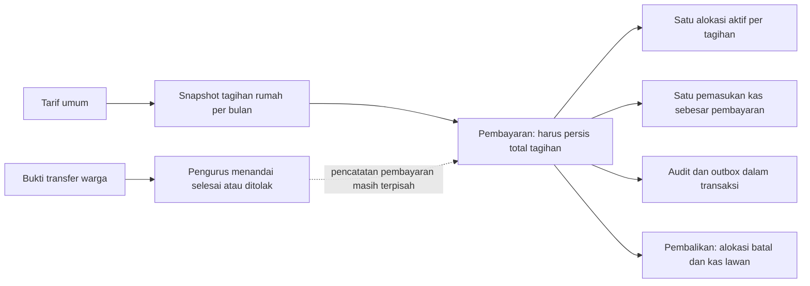

# M18 — Rencana keuangan fleksibel

Tanggal: 25 Oktober 2026. Status: **disetujui pemilik 25 Oktober 2026; implementasi bertahap dimulai**.
Prasyarat M17 passed: PR #81, merge `0f3b251`. Dasar: ADR43 butir 6, BR07/BR10–17, ADR26/27/35.
Keputusan ada di ADR44. Pemilik menyetujui kelanjutan M18 setelah membaca hasil rencana; wajib pengujian luas sebelum staging/production.

## 1. Hasil yang dituju dan keputusan pemilik

Pengurus mencatat uang yang benar-benar diterima, menentukan perlakuan selisih, dan dapat menelusuri koreksinya.
Warga membaca tagihan rumah sendiri serta ringkasan kas tanpa melihat iuran/identitas rumah lain.
Tidak ada gateway, QRIS otomatis, dompet pembayaran, biaya layanan baru, atau integrasi Air Bersih KSM.

**Sudah diputuskan pemilik dalam sesi 25 Okt:** titipan dipakai **atas pilihan pengurus**, bukan otomatis.
Penerimaan titipan menambah kas sekali; pemakaian titipan berikutnya hanya melunasi tagihan dan mengurangi titipan.
Semua pengurus tetap setara sesuai BR07. Istilah “bendahara” di alur bukan role otorisasi baru.

## 2. Alur dan batas kode sekarang (dibaca langsung)

- Domain `Dues` memilih tarif umum, membuat snapshot dengan `insertOrIgnore`, menolak pembayaran kurang/lebih,
  lalu menulis pembayaran, alokasi, kas, audit, outbox dalam transaksi. Rumah dan tagihan dikunci.
- `DuesConfirmations::process` hanya mengubah status bukti; belum terhubung atomik ke pembayaran.
- `Idempotency::run` sudah menyimpan reservasi + hasil transaksi; key sama/payload sama replay, beda payload 409.
- `alokasi_satu_aktif_per_tagihan` mencegah dua cicilan aktif. Tagihan hanya `belum_bayar|lunas`.
  Ringkasan tunggakan menjumlah nominal penuh, bukan sisa; presenter mengambil alokasi pertama.
- Trigger M16 mengunci nominal tagihan/pembayaran/alokasi; kas dan riwayat kas append-only. Pembalikan kas adalah
  nominal bertanda lawan. `CommittedData` mematikan trigger **hanya saat purge database lokal *_test**.
- `Reconciliation` menganggap setiap alokasi sama dengan nominal tagihan, dan total alokasi sama dengan pembayaran.
  Asumsi itu harus diperbarui, bukan sekadar menambahkan form pembayaran sebagian.
- Kas manual memakai advisory lock sendiri, sedangkan pembalikan mengunci pembayaran sebelum rumah; urutan ini
  perlu diseragamkan. Rekonsiliasi harian hanya melaporkan masalah dan tidak memperbaiki data otomatis.
- Kas warga ditutup ADR26/35; `/dues/transparency` tetap khusus pengurus. Kas/rekap/CSV sekarang memakai query terpisah.
  Ekspor CSV sinkron tersedia, XLSX belum ada dalam composer.json maupun composer.lock.

## 3. Perilaku bisnis yang diusulkan

### Tarif dan tagihan

- Tarif umum tetap Rp75.000 sebagai bawaan; tarif khusus rumah memuat nominal, mulai bulan, alasan, aktor, waktu,
  dan riwayat versi. Berlaku sampai diganti atau dikembalikan ke tarif umum sejak bulan yang dipilih.
- Pemilihan tarif: versi khusus efektif untuk rumah/periode mengungguli tarif umum; penanda kembali-umum memakai
  tarif umum efektif periode tersebut. Simpan referensi tarif dan nominal hasilnya pada tagihan saat dibuat.
- **Perubahan tarif tidak menghitung ulang tagihan yang sudah ada.** Tolak tanggal mulai yang menyentuh tagihan
  existing pada/selepas bulan itu; arahkan pengurus ke bulan belum ditagih atau jalur koreksi tagihan eksplisit.
- Batas nominal tarif mengikuti batas umum saat ini Rp1.000–Rp10.000.000. Gratis satu periode dicatat sebagai
  keringanan, bukan tarif nol tersembunyi. Default ini disetujui bersama rencana.
- Koreksi salah input tarif yang belum dipakai: batalkan versi asal dengan alasan, lalu versi pengganti dalam transaksi.
  Tarif yang sudah dirujuk tagihan tetap historis; buat versi untuk bulan berikutnya.
- Kesalahan nominal tagihan existing memakai **penyesuaian tagihan tercatat**, bukan UPDATE snapshot: delta bertanda,
  alasan wajib, aktor/waktu, pembalikan + pengganti saat salah. Nominal efektif = snapshot + penyesuaian aktif.
  Tidak menyentuh kas. Tolak hasil negatif atau lebih kecil dari alokasi + keringanan aktif; pengurus harus membalik
  penyelesaian terkait dulu melalui jalur resmi. Ini koreksi eksplisit, bukan penerapan tarif baru ke masa lalu.

### Penerimaan uang dan selisih

1. Pengurus memilih satu rumah, periode yang sudah dibuat, tanggal penerimaan, dan nominal uang diterima.
2. Pratinjau server menunjukkan sisa masing-masing periode. Alokasi ke periode terpilih mengikuti bulan tertua dahulu.
   Periode yang tidak dipilih tidak disentuh. Pengurus meninjau rincian sebelum konfirmasi.
3. Jika kurang: wajib memilih **Kurang bayar** atau **Lunas dengan keringanan**. Kurang bayar menyisakan tunggakan;
   keringanan menghapus sisa periode terpilih dengan alasan wajib dan rekaman nonkas tersendiri.
4. Jika lebih: wajib memilih **Sumbangan ke kas** atau **Titipan bulan berikutnya**. Seluruh kelebihan masuk salah satu
   pilihan; v1 tidak membagi sebagian sumbangan/sebagian titipan dalam satu penerimaan.
5. Kas menerima **total uang diterima sekali**, termasuk bagian sumbangan/titipan. Detail pembayaran memecah
   alokasi iuran, sumbangan, dan titipan tanpa membuat pemasukan kas kedua.
6. Pembayaran kedua pada periode sudah lunas (misalnya Rp75.000 lalu Rp25.000) diperbolehkan hanya dengan pilihan
   selisih eksplisit: Rp25.000 seluruhnya sumbangan atau titipan. Tanpa pilihan, konflik, bukan dianggap lunas lagi.
7. Tidak membuat pembayaran/kas nominal nol. Keringanan tanpa uang masuk memakai aksi keringanan tersendiri.

### Titipan

- Titipan melekat pada rumah (bukan akun/keluarga yang pindah). Saldo dan riwayat dihitung server dari ledger.
- Tombol **Gunakan titipan**: pilih periode existing, nominal penggunaan maksimal min(saldo titipan, sisa terpilih),
  pratinjau, konfirmasi. Alokasi tertua dahulu; tidak otomatis memotong ketika generator membuat tagihan.
- Aksi ini menghasilkan penggunaan + alokasi + ledger debit titipan + audit/outbox; **tanpa pembayaran uang baru
  dan tanpa transaksi kas baru**. Pemakaian murni titipan tidak dapat sekaligus memberi keringanan.
- Pembatalan penggunaan membalik debit titipan dan menonaktifkan alokasinya, tanpa kas. Sisa tagihan dihitung ulang.
- Kredit titipan dirujuk sebagai lot per pembayaran, penggunaan memakai lot tertua dahulu. Pembayaran asal yang
  titipannya sudah digunakan ditolak untuk dibalik sampai penggunaan terkait dibalik lebih dahulu. UI menampilkan
  dependensi yang harus dibalik; tidak membatalkan pelunasan bulan lain diam-diam.
- Tidak ada transfer titipan antarrumah, pencairan tunai, atau pengembalian dana baru di M18. Arsip rumah tidak
  menghapus titipan; saldo tersisa tetap terlihat pengurus. Kebijakan pengembalian memerlukan keputusan terpisah.

### Bukti transfer dan koreksi

- Bukti warga wajib bernominal positif, bawaan Rp75.000 yang bisa diubah. Mengunggah bukti tidak mengubah kas/tagihan.
- Pengurus memeriksa uang masuk, lalu menyetujui dengan nominal diterima (dapat dikoreksi), tanggal, periode, dan
  pilihan selisih. Nominal pengajuan asli tetap tersimpan; alasan wajib bila nominal diterima berbeda.
- Satu transaksi: lock bukti/rumah → pembayaran + alokasi/keringanan/titipan + kas → tautkan pembayaran → bukti
  selesai → audit/outbox. Key retry dan unique tautan bukti mencegah pembayaran kedua, termasuk dua pengurus.
- Penolakan bukti hanya mengubah keputusan + alasan, tanpa uang. Bukti lama yang sudah selesai tetapi tidak punya
  tautan pembayaran ditandai **historis sebelum M18**; jangan menebak pasangan atau mencatatnya lagi otomatis.
- Pembalikan pembayaran menonaktifkan alokasi dan keringanan yang berasal darinya, membalik kredit titipan yang
  belum digunakan, dan membuat kas lawan sekali. Status tagihan dihitung dari semua penyelesaian tersisa.
- Koreksi pembayaran = pembalikan + pengganti atomik; gagal pengganti mengembalikan seluruh transaksi. Bukti tetap
  merujuk akar rantai pembayaran; UI menelusuri penggantinya. Pembalikan murni ditampilkan sebagai dibatalkan,
  bukan membuka bukti selesai untuk diposting lagi tanpa batas.
- Kas manual mendapat aksi **Koreksi** atomik (reverse + replacement), menggunakan konfirmasi saldo negatif ADR27.
  Keringanan, penggunaan titipan, dan penyesuaian tagihan juga hanya dikoreksi lewat pembalikan + pengganti.
  Nominal/referensi/aktor asal tidak bisa diedit atau dihapus runtime. Alasan minimal 5 karakter, maksimal 300.

## 4. Skema, keamanan transaksi, dan invarian

Migrasi aditif; tidak mengubah nominal historis. Nama berikut rancangan untuk PR DB/domain:

| Entitas | Tambahan minimum |
| --- | --- |
| `tarif_iuran` | Metadata pembatalan/pengganti untuk koreksi tarif umum yang belum dipakai; unique mulai_periode menjadi unique versi aktif; query efektif mengabaikan versi batal |
| `tarif_rumah` | rumah, mode khusus/umum, nominal nullable sesuai mode, mulai_periode, alasan, aktor, waktu, pembatalan, menggantikan_id; satu versi aktif per rumah/bulan |
| `tagihan_iuran` | nullable tarif_rumah_id; snapshot lama tetap. Status kompatibel `belum_bayar|lunas` |
| `penyesuaian_tagihan` | tagihan, delta rupiah bertanda nonnol, alasan, aktor, waktu, membalik_id unique; append-only |
| `keringanan_iuran` | tagihan, nominal positif, pembayaran asal nullable, alasan, aktor, waktu, pembatalan dan pengganti; tidak punya kas |
| `pembayaran_iuran` | nominal_sumbangan dan nominal_titipan default 0; total_bayar tetap uang nyata positif; histori pembalikan existing |
| `penggunaan_titipan` | rumah, tanggal, nominal positif, aktor, waktu, pembatalan dan pengganti; head transaksi penggunaan tanpa uang baru |
| `mutasi_titipan` | rumah, jenis masuk/pakai/pembalikan, nominal positif, pembayaran sumber/lot, penggunaan nullable, membalik_id unique; immutable |
| `alokasi_pembayaran` | pembayaran_id boleh null + penggunaan_titipan_id nullable; tepat satu sumber (XOR); banyak alokasi aktif per tagihan, unik pasangan sumber/tagihan |
| `konfirmasi_iuran` | pembayaran_id nullable unique untuk akar pembayaran; nominal asal tetap. Histori lama tanpa relasi dipertahankan |

Saldo/sisa dihitung dari ledger, bukan saldo bebas-edit baru. Tidak menambah database/layanan baru.
CHECK nilai, jenis, status, XOR sumber, FK RESTRICT, dan unique pembalikan ditulis di DB, bukan hanya Flutter.
Trigger menjaga append-only, pembatalan sekali, kecocokan rumah, dan batas agregat. Kredit titipan masuk harus
merujuk pembayaran sumber; debit harus merujuk lot rumah yang sama. Runtime tidak dapat melewati invarian lewat SQL biasa.

**Invarian (semua integer rupiah, tidak memakai float):**

1. Per tagihan: `terbayar_dari_uang + terbayar_dari_titipan + keringanan + sisa = nominal_efektif`;
   `nominal_efektif = nominal_snapshot + jumlah_delta_penyesuaian`. Semua komponen selain delta nonnegatif.
2. Per pembayaran aktif: `total_bayar = alokasi_uang + sumbangan + kredit_titipan`; tepat satu kas pemasukan
   bernominal `total_bayar`. Keringanan tidak masuk persamaan penerimaan uang.
3. Per penggunaan aktif: jumlah alokasi = jumlah debit lot titipan = nominal penggunaan; kas baru = 0.
4. Saldo titipan rumah/lot = kredit - debit + pembalikan sesuai arah asal, selalu ≥0.
5. Kas penerimaan pembayaran bruto = jumlah uang pada posting pembayaran; setelah koreksi, kas neto terkait
   pembayaran = posting asal + pembalikan. Pemasukan manual/saldo awal dihitung terpisah, bukan dipaksa sama dengan iuran.
6. Kas memakai model bertanda existing: pengeluaran negatif, pembalikan lawan asal. Jangan menambah CHECK `kas.nominal >=0`
   yang merusak ledger. Nilai input pengeluaran positif; server menentukan tandanya.
7. Satu pembalikan penuh per asal, tanpa uang hilang/ganda; histori asal tetap dapat ditelusuri.

**Transaksi dan konkurensi:**

- Gunakan `Idempotency::run` existing untuk setiap mutasi keuangan baru dan persetujuan bukti. Normalisasi payload
  nested/periode secara deterministik sebelum hash; retry mempertahankan key yang sama sampai hasil diketahui.
- Satu advisory transaction lock **`rt05:keuangan`** untuk seluruh mutasi keuangan, termasuk generator, tarif, kas manual,
  pembalikan, keringanan, penyesuaian, titipan. Skala satu RT membenarkan serialisasi singkat ini dan menyederhanakan
  kebenaran. Sesudahnya row lock rumah → bukti/pembayaran → tagihan urut periode/id → lot titipan urut waktu/id.
- Muat ulang nilai sesudah lock. Pratinjau menyertakan fingerprint state keuangan terpilih; perubahan sebelum submit
  menghasilkan 409 `FINANCE_CHANGED`, tanpa posting, lalu pengurus meninjau ulang. Ini mencegah preview lama tiba-tiba
  menjadi sumbangan/titipan setelah admin lain membayar.
- Deferred constraint trigger memeriksa total lintas tabel pada commit dengan lock yang sama; transaksi setengah jadi
  tidak pernah terlihat. Trigger immutable lama diperluas secara sempit, tidak dinonaktifkan untuk operasi bisnis.
- Rekonsiliasi diperluas untuk seluruh persamaan, source XOR, hubungan bukti, lot, pembalikan, dan status tagihan.
  Gunakan snapshot baca konsisten; keluaran hanya jumlah masalah tanpa identitas, exit nonnol jika masalah >0.
- Perbarui urutan cleanup `CommittedData` untuk tabel anak baru; pengecualian trigger hanya koneksi migrasi *_test,
  dinyalakan lagi sebelum commit. Tes harus membuktikan role runtime tetap tidak bisa memodifikasi nominal asal.
- Audit/outbox satu transaksi dengan bisnis. Email/push gagal tidak membatalkan uang yang telah commit.

## 5. Kontrak API, mobile, dan akses

Seluruh path di bawah relatif terhadap `/api/v1`. Kontrak final ditulis bersama tes OpenAPI, bukan ditandai aktif
di dokumen API/ERD sebelum PR implementasi.

| Antarmuka | Perubahan yang direncanakan |
| --- | --- |
| `/admin/dues-rates/{id}/correct` POST | Koreksi versi tarif umum yang belum dirujuk tagihan; alasan wajib, pembalikan versi + pengganti atomik |
| `/admin/houses/{id}/dues-rates` GET/POST | Riwayat dan versi tarif khusus/kembali umum; aksi `/.../{rateId}/correct` dengan alasan |
| `/admin/dues-payments` POST dan `/{id}/correct` | Tambah perlakuan_kurang `kurang_bayar|keringanan`, perlakuan_lebih `sumbangan|titipan`, alasan, versi_keuangan dan fingerprint; total tetap uang diterima |
| `/admin/dues-payments/preview` POST | Read-only rincian alokasi/sisa/keringanan/lebih, fingerprint; tidak mengunci uang atau mencatat pembayaran |
| `/admin/dues-confirmations/{id}/approve` POST | Persetujuan + pembayaran atomik, Idempotency-Key; `/process` hanya penolakan setelah M18 aktif |
| `/admin/houses/{id}/deposits` GET | Saldo dan riwayat lot titipan rumah |
| `/admin/deposit-usages` POST; `/{id}/reverse`, `/{id}/correct` POST | Penggunaan manual dan koreksi, tanpa kas baru |
| `/admin/dues-charges/{id}/reliefs` POST; relief `/{id}/reverse`, `/{id}/correct` POST | Keringanan tanpa penerimaan uang dan koreksi tercatat |
| `/admin/dues-charges/{id}/adjustments` POST; adjustment `/{id}/reverse`, `/{id}/correct` POST | Koreksi nominal efektif tanpa mengedit snapshot atau kas |
| `/admin/cash-transactions/{id}/correct` POST | Pembalikan + kas manual pengganti atomik |
| `/dues/my`, `/admin/houses/{id}/dues`, charges/recap/payments | Tambah nominal_snapshot, nominal_efektif, terbayar, keringanan, sisa, status_pelunasan dan riwayat semua alokasi; titipan hanya rumah sendiri/pengurus |
| `/cash/summary?periode=YYYY-MM` GET | Endpoint warga aktif yang baru, payload allowlist agregat; tidak memakai presenter kas pengurus |
| `/admin/finance-reports?periode=YYYY-MM` atau `?tahun=YYYY` GET | Ringkasan kas dan penyelesaian tagihan dari layanan laporan bersama |
| `/admin/exports/keuangan.xlsx?tahun=YYYY` GET | Workbook privat 14 sheet, no-store, audit, khusus pengurus |

Kode baru minimum: `FINANCE_CHANGED`, `EXCESS_CHOICE_REQUIRED`, `SHORTFALL_CHOICE_REQUIRED`,
`DEPOSIT_INSUFFICIENT`, `DEPOSIT_ALREADY_USED`, `CHARGE_ADJUSTMENT_CONFLICT`, `FINANCE_CLIENT_UPDATE_REQUIRED`.
Kesalahan validasi 422, state konflik 409, akses ditolak 403/404 sesuai kebijakan existing. Tidak mengirim saldo dari client
sebagai kebenaran. Tidak pernah mempublikasikan keterangan kas pengurus ke endpoint warga.

Mobile pengurus: form nominal + pilihan selisih hanya saat relevan, alasan wajib, pratinjau sebelum simpan,
indikator sedang menyimpan dan retry dengan key tetap; hasil memisahkan kas diterima, iuran terbayar, keringanan,
sumbangan, dan titipan. Riwayat menampilkan pembalikan/pengganti dan dependensi pemakaian titipan.
Warga: label **Belum dibayar / Kurang bayar / Lunas / Lunas dengan keringanan**, rincian sendiri dan titipan sendiri;
kas hanya agregat bulanan tanpa kode/nama rumah, nama pembayar, catatan bebas, bukti transfer, maupun daftar tunggakan lain.
Enum status lama tetap dua nilai; label/detail baru diturunkan dari agregat, bukan Flutter menghitung uang sendiri.

**Privasi:** teks M17 masih mengatakan kas hanya untuk pengurus. PR transparansi M18 wajib menyamakan kebijakan
di server/mobile/website/docs dan menaikkan versinya pada tanggal rilis aktual; setuju ulang sesuai mekanisme existing.
Website preview dibangun ulang bila sumber teks berubah. Status iuran rumah lain tetap khusus pengurus.
Saat persetujuan versi M18, client wajib mengirim `versi_teks` dari konstanta teks yang benar-benar ditampilkan;
server menolak nilai berbeda atau tidak ada untuk versi baru. Jangan hanya menyalin versi dari auth/me ke permintaan
persetujuan seperti client lama. APK lama diarahkan memperbarui aplikasi sebelum menyetujui teks M18.

## 6. Laporan dan XLSX

- Satu layanan query laporan dipakai API, CSV yang relevan, dan XLSX. Kas difilter berdasarkan tanggal buku kas WIB;
  penyelesaian tagihan berdasarkan periode tagihan, tidak dicampur menjadi satu total “pemasukan”.
- Bulanan: saldo awal bulan, penerimaan nyata, pengeluaran nyata, koreksi neto terpisah, saldo akhir; iuran langsung,
  sumbangan, titipan diterima/digunakan/tersisa, keringanan dan sisa tagihan ditampilkan terpisah.
  Pembalikan bulan berbeda masuk tanggal pembalikannya, tidak menghapus penerimaan bulan asal.
- Tahunan: 12 bulan termasuk bulan kosong, saldo awal/akhir tahun, total dan rincian koreksi. Pembayaran tahun sebelumnya
  untuk tagihan tahun ini tidak dihitung sebagai kas masuk tahun ini. Saldo awal go-live dibedakan dari penerimaan.
- Tabel penyelesaian/tunggakan adalah **posisi saat laporan dibuat** untuk periode tagihan yang dipilih; tampilkan
  waktu acuannya. Ini berbeda dari arus kas historis per tanggal posting. Jangan mengklaim laporan sebagai snapshot
  status penagihan pada akhir bulan lampau jika sumbernya memakai alokasi/keringanan aktif saat ini.
- XLSX tahunan: **Rekap Tahun**, **Rumah x Bulan**, **01 Januari** hingga **12 Desember**. Tabel rumah×bulan memuat
  nominal efektif/terbayar/keringanan/sisa dan status per bulan; kode rumah hanya dalam ekspor pengurus.
- Header navy/kuning, judul periode, tanggal pembuatan WIB, lebar kolom, format angka rupiah integer, freeze header,
  filter dan total yang sama dengan API. Tidak memerlukan chart, makro, rumus eksternal, atau aplikasi berbayar.
- Nilai angka ditulis numerik, teks pengguna ditulis sebagai string eksplisit (bukan formula); uji `=`, `+`, `-`, `@`,
  tab/CR. Sumber total berasal dari server; jangan menjadikan formula Excel sebagai perhitungan bisnis terpisah.
- Skala satu RT: stream sinkron ke file sementara privat, batas satu tahun per permintaan, snapshot konsisten sebelum
  menulis workbook, hapus file temporer setelah respons; tidak menahan lock tulis selama rendering/unduh.
- **Pustaka usulan: OpenSpout 4.32.0**, gratis, tanpa service eksternal. Composer dry-run pada salinan composer.json/lock
  terisolasi berhasil: **1 paket baru, 0 update, 0 removal** pada PHP 8.4.13; ekstensi dom/fileinfo/filter/libxml/xmlreader/zip
  tersedia lokal. Belum ditambahkan ke repo. Jalankan audit dependency dan cek ekstensi image staging/shared pada PR ekspor.
  Rujukan primer: [repo OpenSpout](https://github.com/openspout/openspout),
  [persyaratan PHP/ekstensi cabang 4.x](https://github.com/openspout/openspout/blob/4.x/composer.json).

## 7. Tes penerimaan yang wajib sebelum M18 passed

| Kasus | Hasil wajib |
| --- | --- |
| 8 rumah × 75.000 + 2 rumah tarif khusus × 50.000 | Kas +700.000; tagihan efektif 700.000; bukan 750.000; rekonsiliasi 0 |
| 10 rumah tagihan 75.000; 2 membayar 50.000 dengan keringanan | Kas +700.000; keringanan 50.000; sisa 0; total tagihan 750.000 |
| Skenario sama tetapi kurang bayar | Kas +700.000; keringanan 0; sisa 50.000; hanya rumah sendiri melihat tunggakannya |
| Rumah menerima 75.000 lalu 25.000 pada bulan sama | Kas +100.000, alokasi iuran 75.000; 25.000 sumbangan atau titipan sesuai pilihan; tanpa pilihan ditolak |
| Cicilan 50.000 + 25.000 pada tagihan 75.000 | Dua pembayaran/alokasi aktif, kas 75.000, sisa 0 |
| Bayar 100.000, titip 25.000, pakai untuk bulan berikutnya | Kas naik 100.000 sekali; penggunaan kas 0, saldo titipan 0, sisa bulan berikutnya 50.000 |
| Bayar kurang pada beberapa bulan | Urutan tertua dan preview cocok, sisa/keringanan tepat per tagihan, tidak menyentuh periode tak dipilih |
| Tarif khusus mulai bulan tertentu, kembali umum, generator ulang/concurrent | Snapshot bulan lama tidak berubah; satu tagihan per rumah/periode; tarif efektif benar |
| Keringanan tanpa pembayaran | Kas 0, keringanan beralasan, pembalikan membuka sisa kembali |
| Koreksi pembayaran/penyesuaian/kas manual | Asal tetap; pembalikan dan pengganti atomik; gagal pengganti rollback seluruhnya |
| Balik pembayaran yang titipannya sudah dipakai | Ditolak tanpa partial write; balik penggunaan terkait dulu, lalu koreksi sumber berhasil |
| Bukti 75.000 disetujui 50.000 | Nominal pengajuan tetap; alasan koreksi, pilihan kekurangan, kas 50.000, satu tautan pembayaran |
| Dua pengurus menyetujui bukti sama atau snapshot berubah | Tepat satu posting; pihak lain conflict/replay; tidak ada kas kedua |
| Klik ganda/retry setelah timeout | Key sama replay; payload beda 409; rollback melepaskan reservasi |
| Dua proses memakai titipan bersamaan | Saldo tidak negatif; penggunaan berlebih ditolak; uji proses Postgres independen |
| SQL runtime mencoba ubah/hapus ledger atau lintas rumah | Ditolak trigger/FK/CHECK; privilege migrasi tidak dipakai runtime |
| Pembalikan lintas bulan/tahun | Saldo awal + masuk - keluar + koreksi = saldo akhir; histori asal tetap |
| API/CSV/XLSX dengan data sama | Total persis sama; 14 sheet dapat dibaca ulang; bulan kosong, rumah arsip, formula-injection aman |
| Warga/pending/tamu mencoba laporan/bukti/rumah lain | Ditolak; payload kas warga hanya allowlist agregat; tidak ada kebocoran identitas |
| Outbox/push gagal dan shared profile | Transaksi tetap committed; retry tidak menggandakan uang; scheduler rekonsiliasi berfungsi |
| Upgrade data M17 dan APK lama | Semua nominal historis sama, rekonsiliasi 0 sebelum/sesudah; client lama tidak melakukan mutasi fleksibel |

Tambahkan tes ke suite backend/kontrak/mobile, bukan mengganti tes lama yang masih berlaku. Kasus M12 yang dulu menolak
parsial diperbarui hanya untuk kontrak baru; penolakan input ambigu tetap diuji. Jalankan suite penuh, Pint, format/analyze,
website bila teks berubah, check-repo, dan rekonsiliasi. Tidak mengisi angka PASS sampai benar-benar dijalankan.

## 8. Urutan PR, kompatibilitas, dan rilis

1. **PR rencana ini:** M18_PLAN + ADR44 usulan + HANDOFF/PROGRESS. Minta persetujuan dokumen konkret sebelum migrasi.
2. **DB/domain:** migrasi aditif, ledger/tarif/koreksi, trigger, Idempotency, rekonsiliasi, tes uang dan concurrency.
   Feature flag `RT05_FINANCE_V2=false` bawaan; seluruh perilaku M17 tetap jalan saat off.
3. **API/kontrak:** endpoint, presenter, policy, OpenAPI + ERD, aturan BR/PRD/TESTING yang berubah, tes denial/contract.
4. **Mobile pengurus:** tarif, pratinjau nominal, bukti, pilihan selisih, titipan manual, koreksi/riwayat, tes widget.
5. **Transparansi warga:** rincian rumah sendiri dan agregat kas, kebijakan privasi baru, tes kebocoran/akses.
6. **Laporan/Excel:** layanan query bersama, XLSX, pengujian pembacaan hasil, batas memori/akses, CI.
7. **Staging lengkap:** backup, rekonsiliasi baseline, deploy immutable SHA main memakai skrip yang hash-nya
   diawali `aa50ca1a`; migrasi, rekonsiliasi, aktifkan flag untuk penerimaan dan uji bendahara/warga di emulator.
   Data sintetis saja. Catat semua skenario finansial dan perbandingan laporan; gate 0 masalah.
8. **Satu APK M18 untuk dibagikan** setelah kumpulan perbaikan selesai. Update `/unduh` + versi.json dan Drive dengan
   file ID tetap; kabari build, hari/tanggal/jam WIB, tautan, dan isi; catat HANDOFF 2a. Nomor build mengikuti CI saat rilis.

Saat flag aktif, mutasi keuangan memerlukan `versi_keuangan=2`; client lama menerima pesan pembaruan, tidak boleh
menandai bukti selesai melalui alur terpisah lama. Read response mempertahankan field/enum lama ditambah rincian baru.
Sebelum aktif, migrasi tidak menghapus indeks lama hingga pengganti constraint terpasang dan tervalidasi atomik.
Snapshot nominal dan transaksi lama tidak dibackfill dengan nilai perkiraan; komponen baru default nol.

Rollback sebelum ada transaksi v2 dapat menonaktifkan flag. **Sesudah transaksi v2 tercatat, jangan deploy kode M17**
yang menganggap satu alokasi/periode. Bekukan mutasi keuangan sementara dan perbaiki maju; baca ledger tetap tersedia.
Restore hanya melalui runbook terverifikasi dengan persetujuan operasional, bukan menghapus transaksi baru.
Pantau rekonsiliasi harian, konflik/duplikasi, outbox, waktu ekspor, dan saldo titipan; tanpa data warga di log.
Production, domain/DNS/firewall, pindah VPS 2 Nov, M19 dan M20 tidak termasuk implementasi M18 ini.

## 9. Daftar keputusan untuk persetujuan dokumen

Tidak perlu menjawab ulang keputusan yang sudah ada. Persetujuan rencana berarti menerima default berikut;
perubahan pemilik dicatat di ADR44 sebelum migrasi.

| Pokok | Status / usulan default |
| --- | --- |
| Titipan otomatis atau manual? | **Sudah dijawab: dipilih pengurus**, tidak ditanyakan ulang |
| Siapa boleh memberi keringanan/tarif khusus? | Semua pengurus (BR07), alasan wajib, audit; tanpa role bendahara terpisah |
| Warga melihat tunggakan/titipan sendiri? | Ya, rumah sendiri saja, termasuk akun tambahan aktif; iuran rumah lain tetap tertutup |
| Tarif nol/bebas permanen? | Tidak ditambah; tarif minimum existing, pembebasan per periode lewat keringanan |
| Titipan saat keluarga pindah/rumah arsip? | Tetap milik rumah sesuai permintaan; tidak dialihkan/dicairkan otomatis |
| Koreksi setelah titipan dipakai? | Balik penggunaan terkait dahulu; jangan membatalkan bulan lain otomatis |
| Kekurangan/kelebihan beberapa periode? | Alokasi tertua dari periode dipilih; keringanan sisa terpilih, kelebihan satu pilihan per penerimaan |
| Koreksi tagihan historis? | Penyesuaian beralasan + pembalikan/pengganti, snapshot asal tetap; tidak memposting uang |
| Format laporan? | Tahun kalender Jan–Des, waktu WIB, 14 sheet, angka API sebagai sumber total |

**Gate persetujuan selesai 25 Oktober 2026:** pemilik meminta lanjut M18 dengan pengujian luas. Implementasi/tes/deploy/rilis tetap harus dibuktikan pada PROGRESS; persetujuan bukan bukti lulus.
