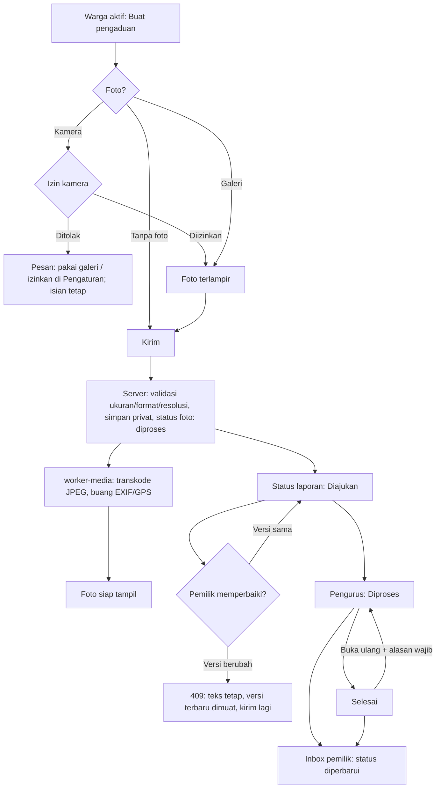
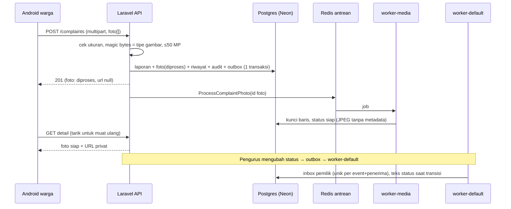

# M08 — bagian Google Doc (dipublikasikan 13 Oktober 2026)

**Status: DIPUBLIKASIKAN ke Doc existing.** Blocker sebelumnya (connector Google Docs tidak
tersedia; connector Drive tidak dapat menyunting isi Doc) diselesaikan lewat editor Google Docs di
Chrome pemilik yang sudah login. Tidak ada Doc baru, sharing dan folder
`1_WweESw5u0iHaDlw6LUfFAuUgOzAstpj` tidak diubah.

| Doc | Yang ditambahkan | Readback |
| --- | --- | --- |
| Panduan `18yoO1-BY7-ylFyujpkDrpp_NkPQOwq-9-mTRPK_-KlM` | Heading "M08: pengaduan warga dan foto", M8.1–M8.5, 8 screenshot Android dengan caption (Gambar 1–8) | `read_file_content`: semua heading dan caption berurutan, tanpa teks nyasar; panduan menjadi 46 halaman menurut editor |
| Laporan `1Dxax50Kckfuc2cCO4_PlanRIlNNQVLpsIN0S42s5VMU` | Bagian "Penerimaan M08 — Pengaduan dan media — 13 Oktober 2026" (hasil, Android, keterbatasan, tautan PR #23) | `read_file_content`: heading, empat paragraf, dan tautan PR #23 terbaca di akhir Doc |

Perbedaan dari draf di bawah: diagram Mermaid dan tabel tidak dipakai (editor tidak merender
Mermaid, dan tabel diketik sebagai paragraf); alur dan sequence ditulis sebagai prosa. Screenshot
yang disisipkan berasal dari putaran 2 (`m08r2-*`), diperkecil ke lebar 280 px dan diunggah sebagai
`M08-A1…A8-*.png` ke folder bukti existing (hanya file baru; tidak ada yang dihapus). Judul Doc
tetap "M06–M07". Ekspor PDF tidak dirender ulang pada sesi ini.

Draf asli di bawah dipertahankan sebagai sumber. Semua isinya hanya perilaku yang sudah diuji
(lokal, CI, staging live, Android); lihat [REPORT.md](REPORT.md).

## M08: Pengaduan warga dan foto

> M08 menyelesaikan pengaduan dari ponsel warga sampai tindak lanjut pengurus. Warga aktif mengirim
> pengaduan dengan kategori, judul, deskripsi, foto opsional (maks. 5), dan pilihan menyembunyikan
> identitas dari warga lain. Pengurus tetap melihat pelapor. Semua contoh memakai data sintetis.

### M8.1 Alur pengaduan

Prosa: foto yang ditolak (bukan JPG/PNG/WebP, palsu, >12 MB, >50 MP) tidak membuat laporan apa pun.
Foto yang sedang diproses hanya terlihat oleh pemilik dan pengurus sebagai "Sedang diproses".
Bila worker berhenti, job menunggu di antrean dan selesai setelah worker berjalan lagi (diuji di
staging); `rt05:media-recover` mengirim ulang foto yang tertahan.

### M8.2 Use case dan hak akses

| Aktor | Boleh | Ditolak |
| --- | --- | --- |
| Warga aktif (pelapor) | Buat, lihat milik sendiri, perbaiki selama Diajukan, terima inbox status | Ubah setelah diproses (403), ubah laporan orang lain (403) |
| Warga aktif lain | Lihat feed/detail tersanitasi dan foto siap | Melihat nama/ID/kontak pelapor anonim; melihat laporan arsip |
| Akun menunggu / nonaktif | — | Semua endpoint pengaduan (403/401) |
| Pengurus | Lihat pelapor, ubah status dengan catatan, buka ulang beralasan, arsipkan beralasan, lihat arsip | Mengubah laporan yang sudah diarsipkan (409) |

### M8.3 Sequence: kirim foto sampai inbox

### M8.4 Screenshot Android (staging sintetis)

Urutan yang disarankan (file di `docs/evidence/m08/screenshots/`):

1. `m08-android-camera-permission-prompt.png` — dialog izin kamera.
2. `m08-android-camera-denied-guidance.png` — izin ditolak, panduan, isian tetap.
3. `m08-android-camera-allowed-photo-attached.png` — izin diberikan, foto terlampir.
4. `m08-android-detail-photos-processing.png` → `m08-android-detail-photos-ready.png` — worker berhenti lalu berjalan lagi.
5. `m08-android-edit-409-draft-kept.png` — konflik versi, teks tetap.
6. `m08-android-other-resident-detail-anonymous.png` — warga lain: identitas disembunyikan, riwayat "Warga".
7. `m08-android-admin-status-processing.png` — pengurus melihat pelapor dan mengubah status.
8. `m08-android-owner-inbox.png` — inbox pemilik.

### M8.5 Keterbatasan (untuk laporan)

- Foto tidak dapat ditambah setelah laporan dibuat (ADR21).
- Pada emulator RAM kecil, Android dapat menutup aplikasi saat kamera terbuka sehingga draf hilang; pemulihan belum dibuat (M15).
- Push FCM belum; pemberitahuan lewat inbox aplikasi.
- Staging sintetis; bukan production atau UAT mitra.
