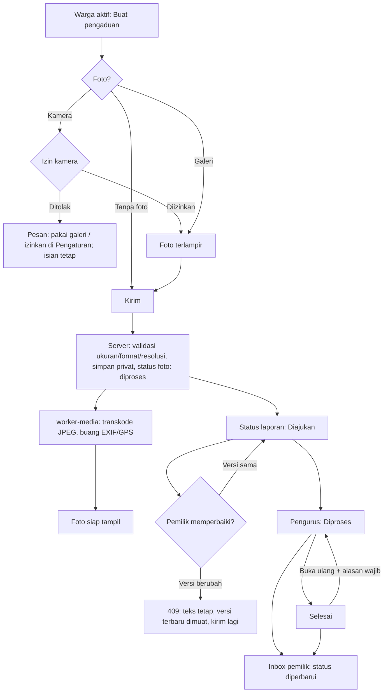
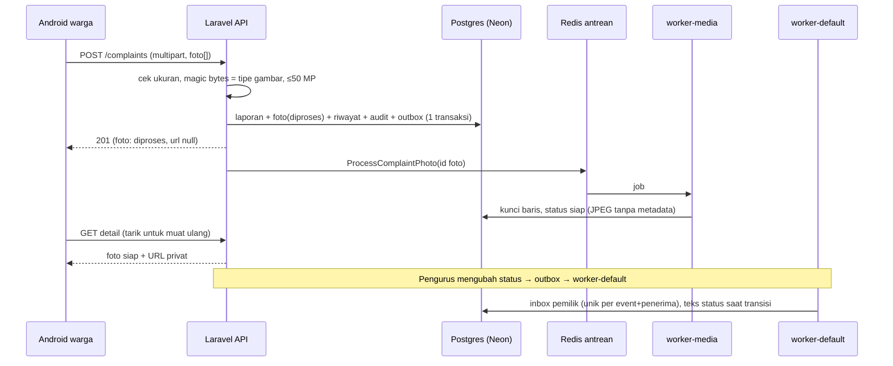

# M08 — draf bagian Google Doc (belum dipublikasikan)

**Status: BLOCKED untuk publikasi native.** Sesi Claude ini hanya memiliki connector Google Drive
(cari, baca teks, buat file baru, ganti nama). Connector **Google Docs** (baca struktur dan edit di
tempat) tidak tersedia, dan sisip gambar ke Doc memerlukan editor tersebut. Mengunggah ulang atau
membuat Doc baru akan menghasilkan duplikat, yang dilarang handoff. Panduan
`18yoO1-BY7-ylFyujpkDrpp_NkPQOwq-9-mTRPK_-KlM` dan laporan
`1Dxax50Kckfuc2cCO4_PlanRIlNNQVLpsIN0S42s5VMU` **tidak diubah**; sharing dan folder
`1_WweESw5u0iHaDlw6LUfFAuUgOzAstpj` tidak disentuh.

Tindakan yang diperlukan: aktifkan connector Google Docs pada sesi berikutnya (atau coordinator
yang memilikinya) lalu sisipkan bagian di bawah ke akhir panduan, satu subbagian per halaman
seperti M07, kemudian baca kembali dan render PDF. Semua isi di bawah hanya perilaku yang sudah
diuji (lokal, CI, staging live, Android); lihat [REPORT.md](REPORT.md).

## M08: Pengaduan warga dan foto

> M08 menyelesaikan pengaduan dari ponsel warga sampai tindak lanjut pengurus. Warga aktif mengirim
> pengaduan dengan kategori, judul, deskripsi, foto opsional (maks. 5), dan pilihan menyembunyikan
> identitas dari warga lain. Pengurus tetap melihat pelapor. Semua contoh memakai data sintetis.

### M8.1 Alur pengaduan

Prosa: foto yang ditolak (bukan JPG/PNG/WebP, palsu, >12 MB, >50 MP) tidak membuat laporan apa pun.
Foto yang sedang diproses hanya terlihat oleh pemilik dan pengurus sebagai "Sedang diproses".
Bila worker berhenti, job menunggu di antrean dan selesai setelah worker berjalan lagi (diuji di
staging); `rt05:media-recover` mengirim ulang foto yang tertahan.

### M8.2 Use case dan hak akses

| Aktor | Boleh | Ditolak |
| --- | --- | --- |
| Warga aktif (pelapor) | Buat, lihat milik sendiri, perbaiki selama Diajukan, terima inbox status | Ubah setelah diproses (403), ubah laporan orang lain (403) |
| Warga aktif lain | Lihat feed/detail tersanitasi dan foto siap | Melihat nama/ID/kontak pelapor anonim; melihat laporan arsip |
| Akun menunggu / nonaktif | — | Semua endpoint pengaduan (403/401) |
| Pengurus | Lihat pelapor, ubah status dengan catatan, buka ulang beralasan, arsipkan beralasan, lihat arsip | Mengubah laporan yang sudah diarsipkan (409) |

### M8.3 Sequence: kirim foto sampai inbox

### M8.4 Screenshot Android (staging sintetis)

Urutan yang disarankan (file di `docs/evidence/m08/screenshots/`):

1. `m08-android-camera-permission-prompt.png` — dialog izin kamera.
2. `m08-android-camera-denied-guidance.png` — izin ditolak, panduan, isian tetap.
3. `m08-android-camera-allowed-photo-attached.png` — izin diberikan, foto terlampir.
4. `m08-android-detail-photos-processing.png` → `m08-android-detail-photos-ready.png` — worker berhenti lalu berjalan lagi.
5. `m08-android-edit-409-draft-kept.png` — konflik versi, teks tetap.
6. `m08-android-other-resident-detail-anonymous.png` — warga lain: identitas disembunyikan, riwayat "Warga".
7. `m08-android-admin-status-processing.png` — pengurus melihat pelapor dan mengubah status.
8. `m08-android-owner-inbox.png` — inbox pemilik.

### M8.5 Keterbatasan (untuk laporan)

- Foto tidak dapat ditambah setelah laporan dibuat (ADR21).
- Pada emulator RAM kecil, Android dapat menutup aplikasi saat kamera terbuka sehingga draf hilang; pemulihan belum dibuat (M15).
- Push FCM belum; pemberitahuan lewat inbox aplikasi.
- Staging sintetis; bukan production atau UAT mitra.
